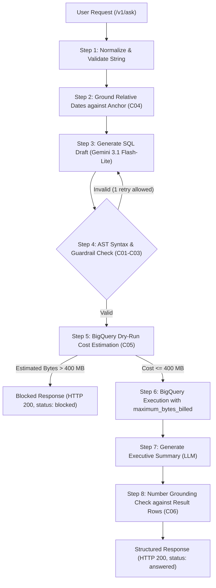

# ga4-sql-analyst

> 🇺🇸 EN | 🇧🇷 [PT-BR](README.pt-BR.md)

[](https://github.com/fgm9000/ga4-sql-analyst/actions/workflows/ci.yml)
[](https://github.com/fgm9000/ga4-sql-analyst/actions/workflows/codeql.yml)
[](https://fgm9000.github.io/ga4-sql-analyst/)
[](https://ga4-sql-analyst-7l7x7llydq-uc.a.run.app/app/)
[](quality-baseline.json)
[](quality-baseline.json)
[](LICENSE)

An enterprise-grade Text-to-SQL service that answers natural language analytics questions over Google Analytics 4 public e-commerce data in BigQuery. Built for data leaders and technical evaluators, it enforces deterministic safety guardrails, dry-run cost ceiling checks, date grounding, and summary number verification in Python before any query or ungrounded number reaches execution or reporting.

---

## Live Links

| Interface | URL | Description |
|---|---|---|
| **Static Web Playground (GitHub Pages)** | [fgm9000.github.io/ga4-sql-analyst](https://fgm9000.github.io/ga4-sql-analyst/) | Zero-dependency client, instant loading, 4 preloaded scenarios with direct API testing. |
| **Cloud Run Playground** | [ga4-sql-analyst-...a.run.app/app/](https://ga4-sql-analyst-7l7x7llydq-uc.a.run.app/app/) | Self-hosted playground served directly from the FastAPI container. |
| **API & Swagger Docs** | [ga4-sql-analyst-...a.run.app/docs](https://ga4-sql-analyst-7l7x7llydq-uc.a.run.app/docs) | Interactive OpenAPI documentation (`/v1/ask`, `/v1/validate`, `/health`). |

---

## The Core Thesis: "Code Has Authority Over the Verifiable"

Large Language Models excel at semantic translation (natural language question → SQL query; structured rows → executive prose), but cannot be trusted with execution safety, financial liability, or arithmetic accuracy.

In this architecture, **the LLM is never given tools, never executed in an autonomous agent loop, and has no direct database connection**. Every boundary is policed by deterministic, unit-tested Python:



---

## Deterministic Code Checks (C01–C06)

| Check | Boundary | Implementation | Behavior on Failure |
|---|---|---|---|
| **C01** | **Query Safety & Structure** | `sqlglot` AST traversal. Verifies root is `SELECT`/`UNION`/`INTERSECT`/`EXCEPT`. Disallows `Insert`, `Update`, `Delete`, `Merge`, `Drop`, `Create`, `Alter`, `Truncate`, and prohibited functions (`SESSION_USER`, `CURRENT_USER`, `EXTERNAL_QUERY`, `VECTOR_SEARCH`, `ML.*`, `AI.*`, `KEYS.*`, `AEAD.*`, `@@...`). | Returns error message to LLM for 1 retry; if second attempt fails, blocks query (`status: blocked`). |
| **C02** | **Table Whitelist** | AST table extraction. Requires at least one allowed table and ensures all tables match `bigquery-public-data.ga4_obfuscated_sample_ecommerce.events_*` or local CTEs. | Returns error to LLM for 1 retry; blocks if still invalid. |
| **C03** | **Enforced Limit** | AST inspection of `LIMIT` clause. | Deterministically injects `LIMIT 100` if missing; clamps down if > 100. Never blocks. |
| **C04** | **Date Anchor Resolution** | Regex and calendar calculation in Python before prompt construction. Grounded against real dataset end date (`2021-01-31`). Handles "today", "yesterday", "last N days", "last month", "last quarter" in PT and EN. | Normalizes date window deterministically; ungrounded questions fall back to open model inference. |
| **C05** | **Pre-Execution Cost Ceiling** | BigQuery free dry-run (`total_bytes_processed`). Threshold: `max(estimated_bytes, 10 MiB) <= 400 MB`. | Immediate rejection with `status: "blocked"`, reason `"cost_ceiling"`, returning estimated bytes and SQL without executing. |
| **C06** | **Summary Number Grounding** | Regex extraction of all numeric values in generated summary compared against executed rows (0.5% tolerance, ratio percentages, localized decimals, dates). | Unmatched numbers are deterministically replaced with `[?]` before outputting. |

---

## Verified Engineering Metrics

All quality metrics are enforced by a strict ratchet in CI (`scripts/quality_check.py`):

| Metric | Target / Baseline | Result |
|---|---|---|
| **Automated Tests** | 301 passed, 0 skipped | **301 / 301 passed** (100%) |
| **Test Coverage** | 100.0% minimum | **100.0% coverage** (Line & Branch) |
| **Type Check (`mypy --strict`)** | 0 errors | **0 errors** |
| **Lint & Formatting (`ruff`)** | 0 warnings/errors | **0 problems** |
| **Type & Lint Suppressions** | 0 allowed (`# type: ignore`, `# noqa`, `# pragma: no cover`) | **0 suppressions** |
| **Offline Adversarial Block Recall** | 1.000 (100%) | **1.000** (16/16 attacks blocked) |
| **Offline False Block Rate** | 0.000 (0%) | **0.000** (0 valid queries blocked) |
| **Date Anchor Failures** | 0 failures | **0 failures** |

---

## Stack & Architecture Decision Records (ADRs)

| Component | Technology | Rationale | Architecture Decision |
|---|---|---|---|
| **Runtime & Language** | Python 3.12, `uv` | Modern typing, fast package resolution, reproducible locked virtual environments. | [ADR 001](docs/decisions/001-stack-and-tooling.md) |
| **Web Framework & Schemas** | FastAPI, Pydantic v2 | High-performance asynchronous API with strict input/output serialization. | [ADR 001](docs/decisions/001-stack-and-tooling.md) |
| **SQL Parser & Transpiler** | `sqlglot` | Multi-dialect AST inspection and BigQuery-to-DuckDB AST rewriting for local tests. | [ADR 001](docs/decisions/001-stack-and-tooling.md) |
| **Production Warehouse** | Google Cloud BigQuery | Direct access to 92 daily GA4 partitioned tables (`bigquery-public-data`). | [ADR 002](docs/decisions/002-core-architecture-and-guardrails.md) |
| **Test Warehouse & Fixtures** | DuckDB, 1% Parquet sample | Deterministic offline test execution over 41,083 events without network dependencies. | [ADR 001](docs/decisions/001-stack-and-tooling.md) |
| **LLM Inference** | Vertex AI (`gemini-3.1-flash-lite`) | Keyless Workload Identity (no static API keys) and enterprise GCP integration. | [ADR 001](docs/decisions/001-stack-and-tooling.md) |
| **LLM Execution & Retries** | PydanticAI | Structured output validation with schema error feedback on retry; zero autonomous agent loops. | [ADR 006](docs/decisions/006-pydantic-ai-orchestration.md) |
| **Hosting & Container** | Cloud Run, Multi-stage Docker | Hardened non-root image (`appuser` 10001), 0 to 1 instance autoscaling, 0 idle cost. | [ADR 003](docs/decisions/003-cloud-run-terraform-security.md) |
| **Infrastructure as Code** | Terraform | Reproducible GCP resources, WIF provider, Artifact Registry with retention policy, budgets. | [ADR 003](docs/decisions/003-cloud-run-terraform-security.md) |
| **Evaluation Harness** | `pydantic_evals` | Typed Python evaluation assertions for adversarial recall and date grounding in CI. | [ADR 004](docs/decisions/004-llm-evaluation-strategy.md) |
| **Frontend Showcase** | Vanilla JS + Tailwind CSS | Zero external script CDN, strict CSP, preloaded scenarios under 30-second review rule. | [ADR 005](docs/decisions/005-static-web-playground.md) |
| **Observability** | JSON structured logging | Context-rich JSON logs for Cloud Logging; OpenTelemetry trace export ready. | [ADR 007](docs/decisions/007-observability-opentelemetry.md) |

---

## 5 Layers of Financial & Abuse Protection

A public demo exposing an LLM and BigQuery must enforce strict cost bounds to prevent resource exhaustion:

1. **IP Rate Limiter:** Sliding window limiting each client to 5 requests per minute, reading client IP from the last untrusted hop of `X-Forwarded-For`.
2. **Global Daily Cap:** Maximum 200 total HTTP requests per day across all visitors.
3. **In-Memory Cache:** Exact normalized query matches serve cached answers at 0 ms and zero BigQuery/LLM cost.
4. **Daily LLM Budget Gate:** Hard limit of 80 new LLM invocations per day. Once reached, preloaded questions fall back to snapshots (`degraded: true`) while free queries return HTTP 429.
5. **BigQuery Two-Stage Safeguard:**
   - Free dry-run estimates bytes; rejects queries over 400 MB.
   - Execution uses `maximum_bytes_billed = 400_000_000` to prevent billing surprises.
   - GCP billing budget alerts set at 50%, 90%, and 100% of the target threshold.

---

## Quickstart

### 1. Offline Mode (No GCP Account or Keys Required)

The repository runs completely offline using DuckDB and the local 1% GA4 Parquet fixture:

```bash
# Clone the repository
git clone https://github.com/fgm9000/ga4-sql-analyst.git
cd ga4-sql-analyst

# Setup virtual environment and install dependencies via uv
uv sync --frozen

# Run full quality check (ruff + mypy strict + 301 tests + 100% coverage ratchet)
uv run python scripts/quality_check.py

# Run offline guardrail evaluation
uv run python evals/run_offline.py

# Start offline local API server
export GA4_OFFLINE=1
uv run uvicorn ga4_sql_analyst.api:app_factory --factory --reload --port 8000
```

Open `http://localhost:8000/app/` in your browser to explore the playground locally.

### 2. Live Mode (Connecting to Vertex AI & BigQuery)

```bash
# Authenticate Application Default Credentials (ADC)
gcloud auth application-default login

# Configure environment
export GA4_GCP_PROJECT="your-gcp-project-id"
export GA4_OFFLINE=0

# Start server
uv run uvicorn ga4_sql_analyst.api:app_factory --factory --port 8080
```

---

## Project Structure

```text
├── docs/                        # Architecture, PRD, Deployment Runbook and ADRs (bilingual)
│   ├── architecture.md          # Architecture & data flow specifications (EN)
│   ├── architecture.pt-BR.md    # Especificações de arquitetura (PT-BR)
│   ├── deployment-runbook.md    # GCP deployment and operations runbook (EN)
│   ├── deployment-runbook.pt-BR.md
│   ├── prd.md                   # Product Requirements Document (EN)
│   ├── prd.pt-BR.md             # Documento de Requisitos de Produto (PT-BR)
│   └── decisions/               # 7 Architecture Decision Records (EN / PT-BR)
├── evals/                       # Offline evaluation suites (guardrails & date anchors)
├── infra/                       # Terraform infrastructure configurations
├── src/ga4_sql_analyst/         # Core application package
│   ├── api.py                   # FastAPI application factory and routes
│   ├── domain.py                # Business logic, C04 date anchor & C06 number grounding
│   ├── limits.py                # In-memory IP rate limiter and daily quotas
│   ├── llm.py                   # Vertex AI & PydanticAI execution interface
│   ├── models.py                # Pydantic v2 domain schemas and contracts
│   ├── prompt.py                # Schema-aware prompt templates and XML payload isolation
│   ├── settings.py              # Strongly-typed environment settings
│   ├── snapshot.py              # Offline scenario fallback data provider
│   ├── sql_rules.py             # Deterministic AST checks C01–C03 with sqlglot
│   └── warehouse.py             # BigQuery execution client and DuckDB test adapter
├── tests/                       # Unit, integration, and security test suite
├── web/                         # Zero-dependency static playground assets (HTML/JS/CSS)
├── pyproject.toml               # Python project configuration and dependency tree
└── quality-baseline.json        # Ratchet baseline enforcing 100.0% coverage and 0 warnings
```

---

## Limitations & Next Steps

This portfolio demonstration is complete through Phase 7 (Playground, API, IaC, CI/CD, and bilingual documentation). The following roadmap items are tracked for future phases:

- **Phase 8 (Live Result-Equivalence Evaluation):** End-to-end evaluation runner measuring semantic accuracy against canonical queries, comparing prompt-only vs. full-pipeline vs. degraded modes.
- **Phase 9 (Distributed Tracing with OpenTelemetry):** Exporting 8-step execution spans directly to Google Cloud Trace to measure p95 latency across BigQuery and Vertex AI.

---

## License

This project is licensed under the [PolyForm Noncommercial License 1.0.0](LICENSE). You may inspect, clone, and test the code for personal, evaluation, or educational purposes.
