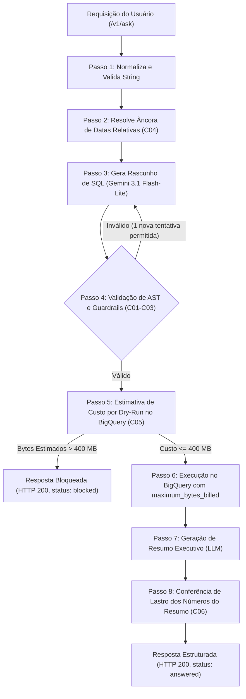

# ga4-sql-analyst

> 🇧🇷 PT-BR | 🇺🇸 [EN](README.md)

[](https://github.com/fgm9000/ga4-sql-analyst/actions/workflows/ci.yml)
[](https://github.com/fgm9000/ga4-sql-analyst/actions/workflows/codeql.yml)
[](https://fgm9000.github.io/ga4-sql-analyst/)
[](https://ga4-sql-analyst-7l7x7llydq-uc.a.run.app/app/)
[](quality-baseline.json)
[](quality-baseline.json)
[](LICENSE)

Serviço corporativo de Text-to-SQL que responde a perguntas analíticas em linguagem natural sobre o dataset público de e-commerce do Google Analytics 4 no BigQuery. Projetado para líderes de dados e avaliadores técnicos, aplica verificações determinísticas de segurança, teto de custo por dry-run, âncora temporal e conferência de números do resumo em Python antes que qualquer consulta ou número inventado chegue à execução ou ao relatório.

---

## Links ao Vivo

| Interface | URL | Descrição |
|---|---|---|
| **Playground Estático (GitHub Pages)** | [fgm9000.github.io/ga4-sql-analyst](https://fgm9000.github.io/ga4-sql-analyst/) | Interface sem dependências externas, abertura instantânea, 4 cenários prontos com teste direto da API. |
| **Playground no Cloud Run** | [ga4-sql-analyst-...a.run.app/app/](https://ga4-sql-analyst-7l7x7llydq-uc.a.run.app/app/) | Playground auto-hospedado servido diretamente pelo container FastAPI. |
| **Documentação da API (Swagger)** | [ga4-sql-analyst-...a.run.app/docs](https://ga4-sql-analyst-7l7x7llydq-uc.a.run.app/docs) | Documentação interativa OpenAPI (`/v1/ask`, `/v1/validate`, `/health`). |

---

## A Tese Central: "O Código Tem Autoridade Sobre o Verificável"

Modelos de linguagem (LLMs) são excelentes tradutores semânticos (pergunta em linguagem natural → query SQL; linhas estruturadas → resumo executivo), mas não devem receber autoridade sobre segurança de execução, responsabilidade financeira ou conferência aritmética.

Nesta arquitetura, **o LLM não possui tools, não executa em loops autônomos de agentes e não tem conexão direta com o banco de dados**. Cada fronteira é controlada por código Python determinístico e coberto por testes unitários:



---

## As 6 Verificações Determinísticas do Código (C01–C06)

| Verificação | Escopo | Implementação | Comportamento em Falha |
|---|---|---|---|
| **C01** | **Segurança da Query** | Inspeção da AST via `sqlglot`. Exige que a raiz seja `SELECT`/`UNION`/`INTERSECT`/`EXCEPT`. Bloqueia nós destrutivos (`Insert`, `Update`, `Delete`, `Merge`, `Drop`, `Create`, `Alter`, `Truncate`) e funções perigosas de ambiente/identidade (`SESSION_USER`, `CURRENT_USER`, `EXTERNAL_QUERY`, `VECTOR_SEARCH`, `ML.*`, `AI.*`, `KEYS.*`, `AEAD.*`, `@@...`). | Devolve mensagem de erro ao LLM para 1 nova tentativa; se falhar novamente, bloqueia a requisição (`status: blocked`). |
| **C02** | **Lista de Tabelas Permitidas** | Extração de tabelas na AST. Exige pelo menos uma tabela permitida e restringe a `bigquery-public-data.ga4_obfuscated_sample_ecommerce.events_*` ou CTEs locais. | Devolve erro ao LLM para 1 nova tentativa; bloqueia se persistir inválido. |
| **C03** | **Limite Obrigatório** | Inspeção da cláusula `LIMIT` na AST. | Injeta deterministicamente `LIMIT 100` se ausente; reduz se > 100. Nunca bloqueia. |
| **C04** | **Resolução da Âncora Temporal** | Expressões regulares e cálculo de calendário em Python antes da montagem do prompt. Ancorado no fim real do dataset (`31/01/2021`). Trata "hoje", "ontem", "últimos N dias", "último mês" (mês civil anterior) e "último trimestre" em PT e EN. | Normaliza o intervalo de datas deterministicamente; perguntas sem período deixam a escolha em aberto para o modelo. |
| **C05** | **Teto de Custo Pré-Execução** | Dry-run gratuito no BigQuery (`total_bytes_processed`). Regra: `max(bytes_estimados, 10 MiB) <= 400 MB`. | Recusa imediata com HTTP 200, `status: "blocked"`, motivo `"cost_ceiling"`, devolvendo os bytes estimados e a query sem gastar execução. |
| **C06** | **Lastro dos Números do Resumo** | Extração de todos os numerais no texto gerado e conferência contra as linhas retornadas (tolerância de 0,5%, percentuais de razões, formatos decimais locais, datas). | Numerais sem lastro nos dados são deterministicamente substituídos por `[?]` antes da saída. |

---

## Métricas de Engenharia Comprovadas

Todas as métricas de qualidade são verificadas por uma catraca estrita no CI (`scripts/quality_check.py`):

| Métrica | Meta / Baseline | Resultado Real |
|---|---|---|
| **Testes Automatizados** | 301 passando, 0 ignorados | **301 / 301 passando** (100%) |
| **Cobertura de Código** | 100.0% estrito | **100.0% de cobertura** (Linhas e Ramificações) |
| **Tipagem Estrita (`mypy --strict`)** | 0 erros | **0 erros** |
| **Lint e Formatação (`ruff`)** | 0 problemas | **0 problemas** |
| **Supressões no Código** | 0 permitidas (`# type: ignore`, `# noqa`, `# pragma: no cover`) | **0 supressões** |
| **Recall de Bloqueio Adversarial (Eval Offline)** | 1,000 (100%) | **1,000** (16 de 16 ataques bloqueados) |
| **Taxa de Falso Bloqueio** | 0,000 (0%) | **0,000** (0 queries válidas bloqueadas) |
| **Falhas na Âncora de Data** | 0 falhas | **0 falhas** |

---

## Stack Tecnológica e Registro de Decisões de Arquitetura (ADRs)

| Componente | Tecnologia | Motivação | Registro de Decisão |
|---|---|---|---|
| **Linguagem & Ambiente** | Python 3.12, `uv` | Tipagem moderna, resolução ultrarrápida de dependências e venv reprodutível. | [ADR 001](docs/decisions/001-stack-and-tooling.pt-BR.md) |
| **API & Contratos** | FastAPI, Pydantic v2 | API assíncrona de alta performance com validação e serialização estrita de schemas. | [ADR 001](docs/decisions/001-stack-and-tooling.pt-BR.md) |
| **Parser e Transpiler SQL** | `sqlglot` | Inspeção da AST e tradução BigQuery → DuckDB em nível de nós para testes locais. | [ADR 001](docs/decisions/001-stack-and-tooling.pt-BR.md) |
| **Warehouse em Produção** | Google Cloud BigQuery | Acesso nativo às 92 tabelas diárias particionadas do GA4 público. | [ADR 002](docs/decisions/002-core-architecture-and-guardrails.pt-BR.md) |
| **Warehouse Local de Testes** | DuckDB, amostra de 1% em Parquet | Execução determinística dos 301 testes offline sobre 41.083 eventos sem dependência de rede. | [ADR 001](docs/decisions/001-stack-and-tooling.pt-BR.md) |
| **Inferência de LLM** | Vertex AI (`gemini-3.1-flash-lite`) | Autenticação keyless via Workload Identity (sem chaves estáticas de API) em GCP. | [ADR 001](docs/decisions/001-stack-and-tooling.pt-BR.md) |
| **Execução e Retentativa do LLM** | PydanticAI | Saída estruturada tipada com feedback de erro sintático na retentativa; sem loops autônomos. | [ADR 006](docs/decisions/006-pydantic-ai-orchestration.pt-BR.md) |
| **Container & Hospedagem** | Cloud Run, Docker multi-stage | Imagem hardened sem root (`appuser` 10001), escala de 0 a 1 instância, zero custo ocioso. | [ADR 003](docs/decisions/003-cloud-run-terraform-security.pt-BR.md) |
| **Infraestrutura como Código** | Terraform | Recursos reprodutíveis no GCP, provider WIF dedicado, Artifact Registry com retenção. | [ADR 003](docs/decisions/003-cloud-run-terraform-security.pt-BR.md) |
| **Suíte de Avaliação de IA** | `pydantic_evals` | Asserções tipadas em Python para recall adversarial e âncora de data no CI. | [ADR 004](docs/decisions/004-llm-evaluation-strategy.pt-BR.md) |
| **Interface Visual (Playground)** | Vanilla JS + Tailwind CSS | Sem dependência de CDN externo, CSP estrita, cenários pré-carregados para avaliação rápida. | [ADR 005](docs/decisions/005-static-web-playground.pt-BR.md) |
| **Observabilidade** | Logs estruturados em JSON | Logs contextuais para Cloud Logging; pronto para rastreamento distribuído via OpenTelemetry. | [ADR 007](docs/decisions/007-observability-opentelemetry.pt-BR.md) |

---

## 5 Camadas de Proteção Financeira e Anti-Abuso

Uma demonstração pública com acesso a LLM e BigQuery requer salvaguardas financeiras estritas:

1. **Rate Limiting por IP:** Janela deslizante limitando cada visitante a 5 requisições/minuto, extraindo o IP real do último hop não-confiável de `X-Forwarded-For`.
2. **Teto Diário Global:** Limite máximo de 200 requisições HTTP por dia em todo o serviço.
3. **Cache em Memória:** Perguntas idênticas normalizadas são respondidas instantaneamente em 0 ms sem consumir BigQuery ou LLM.
4. **Cota Diária de Novas Chamadas ao LLM:** Teto de 80 invocações de modelo por dia. Esgotada a cota, perguntas prontas utilizam dados em cache/snapshot (`degraded: true`) e novas perguntas recebem HTTP 429.
5. **Dupla Trava no BigQuery:**
   - Dry-run prévio gratuito calcula os bytes e rejeita consultas acima de 400 MB.
   - Execução com `maximum_bytes_billed = 400_000_000` como segunda barreira inegociável.
   - Alerta de orçamento GCP configurado para 50%, 90% e 100% do limite estipulado.

---

## Início Rápido (Quickstart)

### 1. Modo Offline (Sem conta GCP ou chaves)

O repositório funciona 100% offline utilizando DuckDB e a amostra local de 1% do GA4:

```bash
# Clone o repositório
git clone https://github.com/fgm9000/ga4-sql-analyst.git
cd ga4-sql-analyst

# Configure o ambiente e instale dependências via uv
uv sync --frozen

# Execute a catraca completa de qualidade (ruff + mypy strict + 301 testes + 100% cobertura)
uv run python scripts/quality_check.py

# Execute a suíte de avaliação offline de guardrails
uv run python evals/run_offline.py

# Inicie o servidor local em modo offline
export GA4_OFFLINE=1
uv run uvicorn ga4_sql_analyst.api:app_factory --factory --reload --port 8000
```

Abra `http://localhost:8000/app/` no navegador para utilizar o playground localmente.

### 2. Modo Conectado (Produção contra Vertex AI e BigQuery)

```bash
# Autentique suas credenciais padrão de aplicação (ADC)
gcloud auth application-default login

# Configure as variáveis de ambiente
export GA4_GCP_PROJECT="seu-projeto-gcp"
export GA4_OFFLINE=0

# Inicie o servidor
uv run uvicorn ga4_sql_analyst.api:app_factory --factory --port 8080
```

---

## Estrutura do Repositório

```text
├── docs/                        # Arquitetura, PRD, Runbook de Deploy e ADRs (bilíngues)
│   ├── architecture.md          # Especificações de arquitetura e fluxo de dados (EN)
│   ├── architecture.pt-BR.md    # Especificações de arquitetura (PT-BR)
│   ├── deployment-runbook.md    # Runbook operacional de deploy no GCP (EN)
│   ├── deployment-runbook.pt-BR.md
│   ├── prd.md                   # Product Requirements Document (EN)
│   ├── prd.pt-BR.md             # Documento de Requisitos de Produto (PT-BR)
│   └── decisions/               # 7 Architecture Decision Records (EN / PT-BR)
├── evals/                       # Suítes de avaliação offline (guardrails e âncora de data)
├── infra/                       # Código de infraestrutura Terraform
├── src/ga4_sql_analyst/         # Pacote principal da aplicação
│   ├── api.py                   # Factory FastAPI e rotas de endpoint
│   ├── domain.py                # Regras de negócio, âncora temporal C04 e lastro C06
│   ├── limits.py                # Rate limiter por IP e controle de cotas diárias
│   ├── llm.py                   # Interface de execução Vertex AI e PydanticAI
│   ├── models.py                # Contratos e schemas Pydantic v2
│   ├── prompt.py                # Templates de prompt com isolamento XML de payloads
│   ├── settings.py              # Configurações tipadas do ambiente
│   ├── snapshot.py              # Provedor de dados de fallback offline
│   ├── sql_rules.py             # Verificações determinísticas de AST C01–C03 com sqlglot
│   └── warehouse.py             # Cliente de execução BigQuery e adaptador DuckDB
├── tests/                       # Suíte de testes unitários, integração e segurança
├── web/                         # Playground estático sem dependências (HTML/JS/CSS)
├── pyproject.toml               # Configuração do projeto e dependências travadas
└── quality-baseline.json        # Baseline da catraca (100.0% cobertura e 0 problemas)
```

---

## Limitações e Próximos Passos

Esta demonstração de portfólio está concluída até a Fase 7 (Playground, API, IaC, CI/CD e documentação bilíngue). Os seguintes itens de roadmap estão documentados para iterações futuras:

- **Fase 8 (Avaliação Live de Equivalência de Resultados):** Suíte de testes ponta a ponta avaliando a acurácia semântica dos resultados executados contra queries canônicas de referência, comparando as 3 variantes de pipeline.
- **Fase 9 (Rastreabilidade Distribuída com OpenTelemetry):** Exportação de spans das 8 etapas do pipeline diretamente para o Google Cloud Trace para monitorar latência p95.

---

## Licença

Este projeto é disponibilizado sob os termos da licença [PolyForm Noncommercial License 1.0.0](LICENSE). É permitida a inspeção, cópia e execução para fins pessoais, educacionais e de avaliação técnica.
