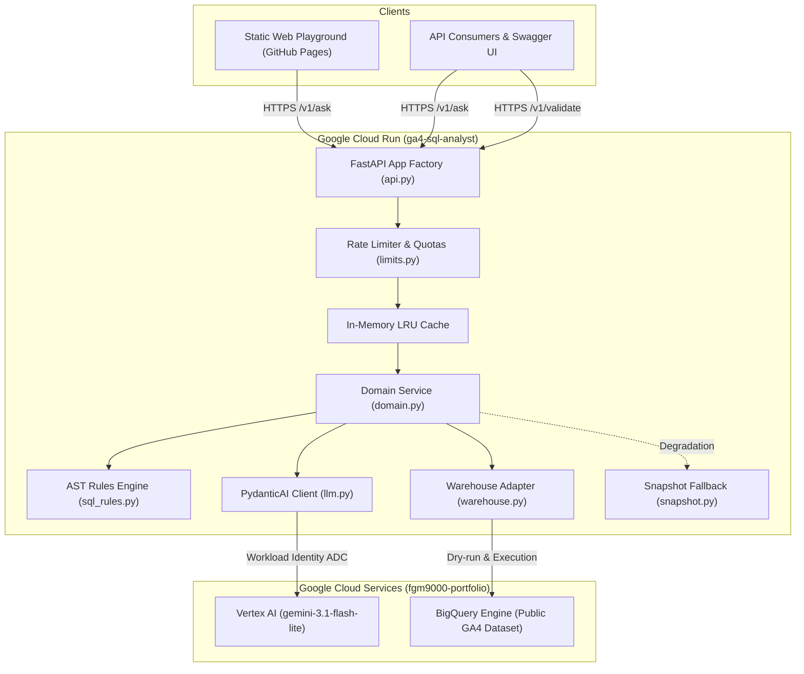
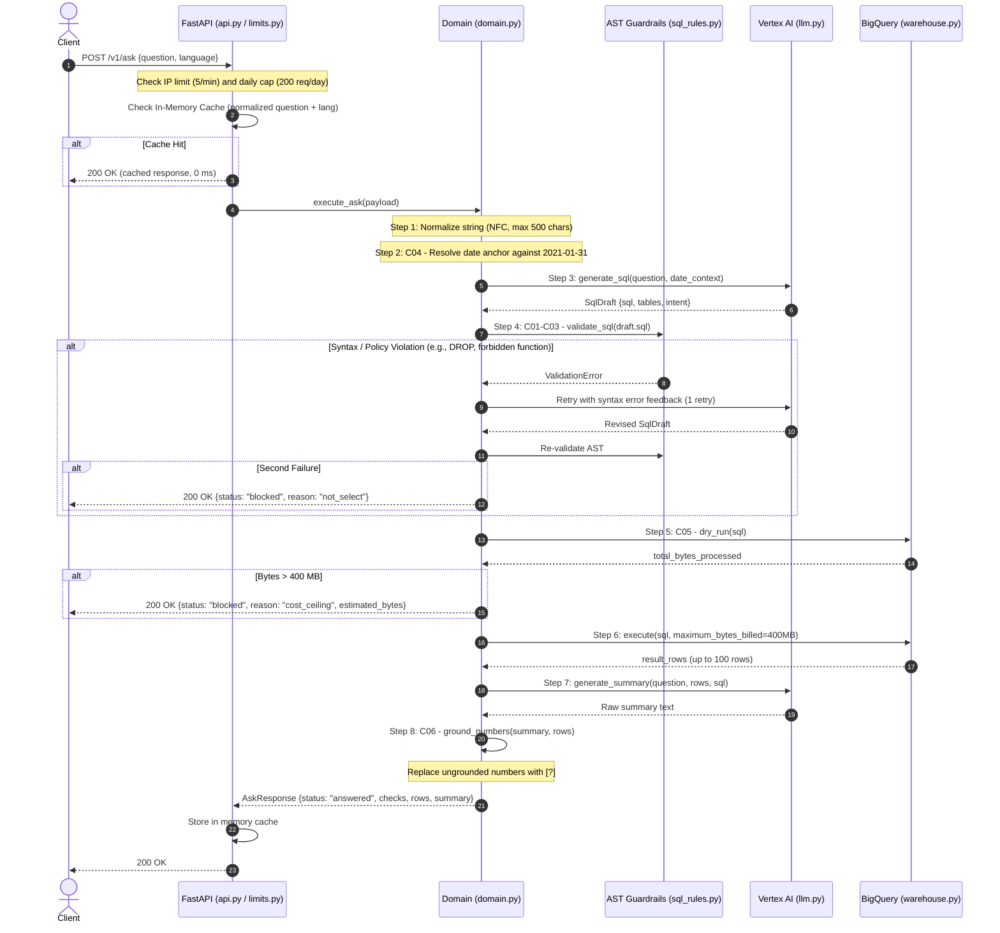

# System Architecture — ga4-sql-analyst

> 🇺🇸 EN | 🇧🇷 [PT-BR](architecture.pt-BR.md)

This document details the architectural boundaries, security invariants, data flow, and degradation semantics of `ga4-sql-analyst`.

---

## 1. System Overview

`ga4-sql-analyst` is a stateless, keyless analytics backend and accompanying static playground that enables users to query Google Analytics 4 e-commerce data in BigQuery using natural language questions in English or Portuguese.

---

## 2. End-to-End Sequence Diagram (`POST /v1/ask`)

The execution strictly follows an 8-step pipeline where non-deterministic LLM operations are bounded by deterministic Python checks:

---

## 3. Deterministic Invariants & Verification Suite

### C01: Single Statement & Read-Only AST
- Built using `sqlglot` parser for Google BigQuery dialect.
- Must parse into exactly one SQL statement.
- Root expression must be `Select`, `Union`, `Intersect`, or `Except`.
- Disallowed AST nodes: `Insert`, `Update`, `Delete`, `Merge`, `Drop`, `Create`, `Alter`, `Command`, `TruncateTable`.
- Prohibited environment/identity functions: `SESSION_USER`, `CURRENT_USER`, `EXTERNAL_QUERY`, `EXTERNAL_OBJECT_TRANSFORM`, `VECTOR_SEARCH`, `ML.*`, `AI.*`, `KEYS.*`, `AEAD.*`, `DETERMINISTIC_ENCRYPT`, `DETERMINISTIC_DECRYPT`, and system variables (`@@...`).

### C02: Table Whitelist Enforcement
- Scans all table references in the AST.
- Must include at least one allowed table.
- All referenced tables must belong to:
  `bigquery-public-data.ga4_obfuscated_sample_ecommerce.events_*` or
  `bigquery-public-data.ga4_obfuscated_sample_ecommerce.events_YYYYMMDD` (or locally defined CTEs within `WITH` expressions).

### C03: Bounded Query Results (`LIMIT 100`)
- Detects the top-level `LIMIT` clause.
- Injects `LIMIT 100` if absent.
- Clamps values exceeding 100 down to 100.
- Never blocks valid queries; acts as an idempotent AST transform.

### C04: Deterministic Relative Date Anchor
- The public GA4 sample ends on **January 31, 2021** (92 partitioned daily tables from `2020-11-01` to `2021-01-31`).
- Queries requesting "today", "yesterday", "last 30 days", "last month", or "last quarter" are resolved deterministically before prompt rendering:
  - `"today"` / `"hoje"` = `2021-01-31`
  - `"yesterday"` / `"ontem"` = `2021-01-30`
  - `"last 30 days"` / `"últimos 30 dias"` = `2021-01-02` to `2021-01-31`
  - `"last month"` / `"último mês"` = Previous calendar month (`2020-12-01` to `2020-12-31`)
  - `"last quarter"` / `"último trimestre"` = `2020-11-01` to `2020-12-31` (clamped to dataset start)

### C05: Pre-Execution Dry-Run Cost Ceiling
- Performs a free dry-run against BigQuery API with `use_query_cache=False`.
- Evaluates: `max(estimated_bytes, 10_485_760) <= 400_000_000`.
- Queries exceeding 400 MB (e.g., unbounded scans across all 92 tables) are rejected with HTTP 200, returning `status: "blocked"` and the exact estimated bytes.

### C06: Executive Summary Number Grounding
- Parses all numeric tokens in the generated summary.
- Verifies that every number matches:
  - Exact cell values from result rows.
  - Derived ratios and percentages within a 0.5% tolerance.
  - Row counts (e.g., "top 10").
  - Formatted dates and timestamp components.
- Any fabricated number that lacks grounding in query output is deterministically replaced with `[?]`.

---

## 4. Graceful Degradation Semantics

The system is designed never to crash or show an unhandled error during service disruptions:

| Failure Mode | Preloaded Scenario | Free Natural Language Query |
|---|---|---|
| **Vertex AI Unavailable / Quota Exhaustion** | Serves static snapshot with `degraded: true` | Returns HTTP 200 with `status: "unavailable"` |
| **BigQuery API Down / Network Error** | Serves static snapshot with `degraded: true` | Returns generated SQL and AST check results with empty rows and `degraded: true` |
| **Executive Summary Failure** | Serves static snapshot | Returns query results with `summary: null` and `reason: "summary_unavailable"` |
| **Daily LLM Quota Exhausted (80/day)** | Serves static snapshot with `degraded: true` | Returns HTTP 429 with `daily_llm_quota` |
| **Client Rate Limit Exceeded (5 req/min)** | Returns HTTP 429 with `Retry-After` | Returns HTTP 429 with `Retry-After` |

---

## 5. Security & Deployment Architecture

1. **Keyless Cloud Run:** Container runs under a dedicated service account `ga4-sql-analyst-runtime` granted only `roles/bigquery.jobUser` and `roles/aiplatform.user`.
2. **Workload Identity Federation (WIF):** GitHub Actions deploys via OIDC federation without any persistent JSON service account keys.
3. **Hardened Container:** Multi-stage build with non-root user `appuser` (UID 10001), read-only virtual environment, and zero write permissions on root filesystem.
4. **Content Security Policy (CSP):** The web playground is served with strict CSP headers, zero external CDN scripts, and complete separation between data and executable code.
