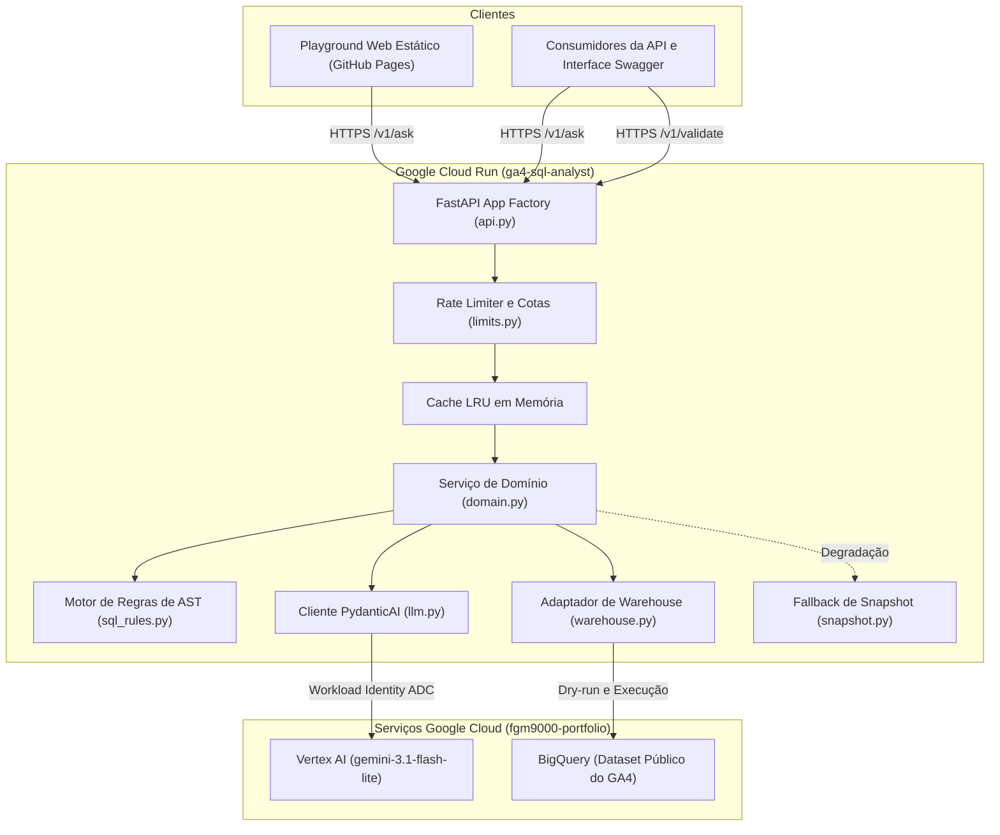
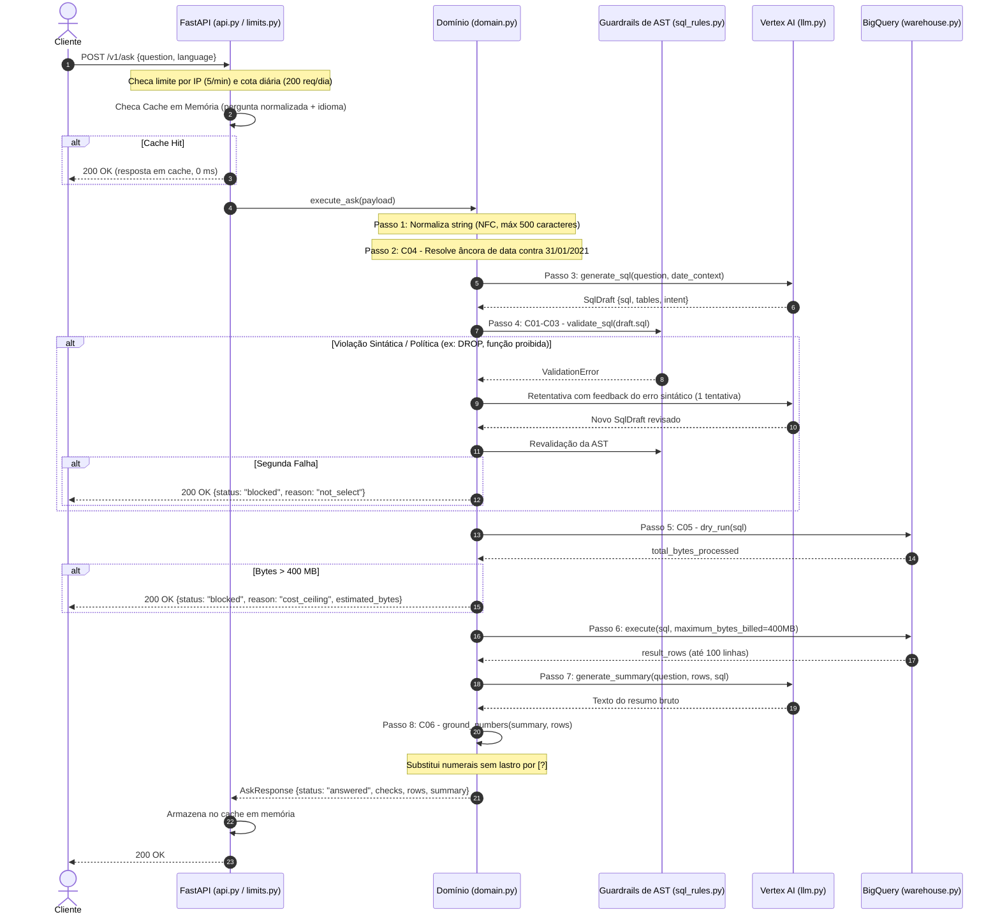

# Arquitetura do Sistema — ga4-sql-analyst

> 🇧🇷 PT-BR | 🇺🇸 [EN](architecture.md)

Este documento detalha os limites arquiteturais, invariantes de segurança, fluxo de dados e semântica de degradação do `ga4-sql-analyst`.

---

## 1. Visão Geral do Sistema

O `ga4-sql-analyst` é um backend analítico sem estado e sem chaves estáticas, acompanhado de um playground web estático, permitindo consultar dados públicos de e-commerce do Google Analytics 4 no BigQuery utilizando perguntas em linguagem natural em inglês ou português.

---

## 2. Diagrama de Sequência (`POST /v1/ask`)

O pipeline executa rigorosamente um fluxo linear de 8 passos onde operações não-determinísticas de IA são delimitadas por verificações determinísticas em Python:

---

## 3. Invariantes Determinísticos e Conjunto de Verificações

### C01: Declaração Única e AST Somente Leitura
- Implementado via parser `sqlglot` configurado para o dialeto BigQuery.
- A query deve conter exatamente um comando SQL.
- A raiz da expressão deve ser `Select`, `Union`, `Intersect` ou `Except`.
- Nós proibidos: `Insert`, `Update`, `Delete`, `Merge`, `Drop`, `Create`, `Alter`, `Command`, `TruncateTable`.
- Funções de ambiente e identidade proibidas: `SESSION_USER`, `CURRENT_USER`, `EXTERNAL_QUERY`, `EXTERNAL_OBJECT_TRANSFORM`, `VECTOR_SEARCH`, `ML.*`, `AI.*`, `KEYS.*`, `AEAD.*`, `DETERMINISTIC_ENCRYPT`, `DETERMINISTIC_DECRYPT` e variáveis de sistema (`@@...`).

### C02: Lista de Tabelas Permitidas
- Varre todas as referências de tabelas na árvore sintática.
- Deve conter ao menos uma tabela permitida.
- Todas as tabelas devem pertencer ao padrão:
  `bigquery-public-data.ga4_obfuscated_sample_ecommerce.events_*` ou
  `bigquery-public-data.ga4_obfuscated_sample_ecommerce.events_YYYYMMDD` (ou CTEs locais definidas no bloco `WITH`).

### C03: Limite Obrigatório de Linhas (`LIMIT 100`)
- Detecta a cláusula `LIMIT` na AST.
- Injeta deterministicamente `LIMIT 100` se estiver ausente.
- Reduz valores superiores a 100 para o teto de 100.
- Nunca bloqueia consultas válidas; atua como transformação idempotente da AST.

### C04: Âncora Temporal Determinística
- O dataset público de GA4 encerra em **31 de janeiro de 2021** (92 tabelas diárias de `01/11/2020` a `31/01/2021`).
- Perguntas que mencionam "hoje", "ontem", "últimos 30 dias", "último mês" ou "último trimestre" são resolvidas deterministicamente antes de chamar o modelo:
  - `"hoje"` / `"today"` = `2021-01-31`
  - `"ontem"` / `"yesterday"` = `2021-01-30`
  - `"últimos 30 dias"` / `"last 30 days"` = `2021-01-02` a `2021-01-31`
  - `"último mês"` / `"last month"` = Mês civil anterior (`2020-12-01` a `2020-12-31`)
  - `"último trimestre"` / `"last quarter"` = `2020-11-01` a `2020-12-31` (truncado no início do dataset)

### C05: Teto de Custo Pré-Execução por Dry-Run
- Executa dry-run gratuito na API do BigQuery com `use_query_cache=False`.
- Avalia: `max(bytes_estimados, 10_485_760) <= 400_000_000`.
- Consultas que excederem 400 MB (ex.: scans sem filtro em todas as 92 tabelas) são recusadas com HTTP 200, `status: "blocked"` e os bytes exatos estimados.

### C06: Conferência de Lastro dos Números do Resumo
- Extrai todos os numerais no texto do resumo gerado.
- Confere se cada numeral corresponde a:
  - Valores exatos de células retornadas.
  - Proporções e percentuais derivados dentro de uma tolerância de 0,5%.
  - Contagens de linhas (ex.: "top 10").
  - Datas e componentes temporais formatados.
- Qualquer número sem lastro é deterministicamente substituído por `[?]`.

---

## 4. Semântica de Degradação Graciosa (*Graceful Degradation*)

O sistema foi arquitetado para nunca quebrar ou retornar erros não tratados:

| Modo de Falha | Pergunta Pré-Carregada | Pergunta Livre |
|---|---|---|
| **Vertex AI Indisponível / Cota Esgotada** | Responde via snapshot com `degraded: true` | Retorna HTTP 200 com `status: "unavailable"` |
| **BigQuery Indisponível / Falha de Rede** | Responde via snapshot com `degraded: true` | Retorna SQL gerado e verificações com linhas vazias e `degraded: true` |
| **Falha na Geração do Resumo** | Responde via snapshot | Retorna resultado com `summary: null` e `reason: "summary_unavailable"` |
| **Cota Diária de LLM Esgotada (80/dia)** | Responde via snapshot com `degraded: true` | Retorna HTTP 429 com `daily_llm_quota` |
| **Limite por IP Excedido (5 req/min)** | Retorna HTTP 429 com `Retry-After` | Retorna HTTP 429 com `Retry-After` |

---

## 5. Segurança e Arquitetura de Nuvem

1. **Cloud Run Sem Chaves Estáticas:** O container opera sob a Service Account `ga4-sql-analyst-runtime`, contendo apenas `roles/bigquery.jobUser` e `roles/aiplatform.user`.
2. **Workload Identity Federation (WIF):** O GitHub Actions autentica via federação OIDC sem chaves JSON de serviço.
3. **Container Hardened:** Imagem multi-stage executando como usuário não-root `appuser` (UID 10001), ambiente virtual somente leitura e sistema de arquivos imutável.
4. **Política de Segurança de Conteúdo (CSP):** O playground opera sob CSP estrita, sem dependência de CDNs externos e com separação completa entre dados e código executável.
